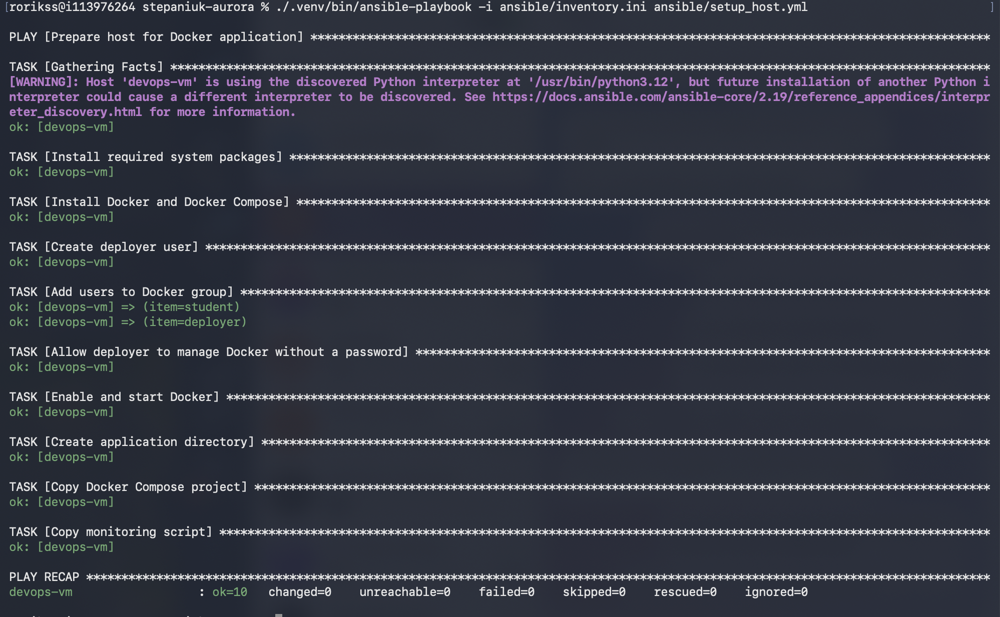
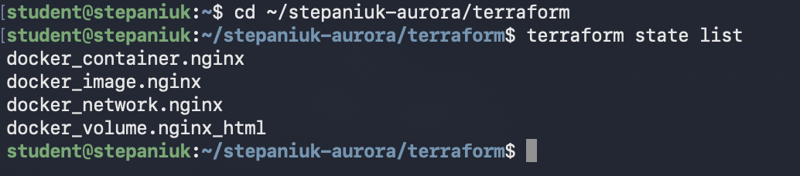
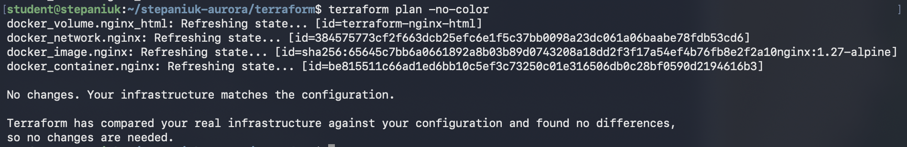
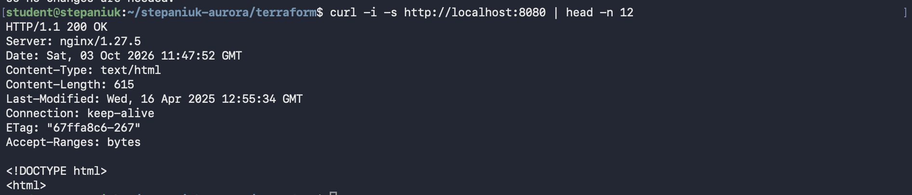
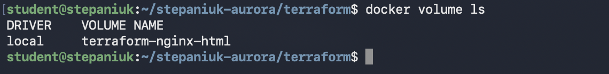
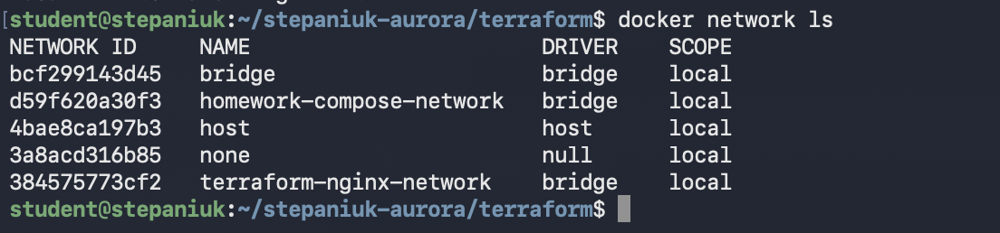
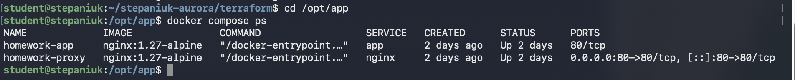
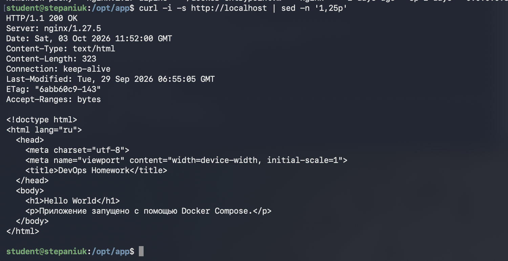
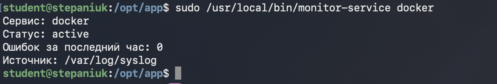

# Фундамент DevOps-инфраструктуры

Учебный проект показывает последовательную настройку одной виртуальной машины:
сначала Ansible устанавливает Docker, затем Terraform создаёт Docker-ресурсы, а
Docker Compose запускает отдельное окружение из двух сервисов.

## Архитектура

```text
Ansible
└── Ubuntu VM: Docker, Compose, deployer, monitor-service

Terraform Docker provider
└── terraform-nginx-network
    └── terraform-nginx :8080 -> :80
        └── terraform-nginx-html

Docker Compose
└── homework-compose-network
    ├── homework-proxy :80 -> :80
    └── homework-app :80
```

Terraform-контейнер и контейнеры Compose находятся в разных пользовательских
сетях. Это можно проверить командой `docker network ls`.

## Структура проекта

```text
.
├── ansible/       # подготовка VM
├── terraform/     # Nginx, отдельная сеть и том через Docker provider
├── compose/       # reverse proxy и приложение в другой сети
├── scripts/       # мониторинг systemd-сервисов
└── docs/          # результаты проверки
```

## 1. Подготовка VM через Ansible

Ansible выполняется первым, потому что Terraform Docker provider работает только
после установки и запуска Docker Engine.

Для доступа используется SSH-ключ. Если он ещё не добавлен:

```bash
ssh-copy-id student@111.88.162.43
```

Запуск playbook:

```bash
cd ansible
ansible-playbook -i inventory.ini setup_host.yml
```

Playbook:

- устанавливает Docker Engine и Docker Compose;
- создаёт пользователя `deployer`;
- добавляет `student` и `deployer` в группу `docker`;
- включает автозапуск Docker;
- разрешает `deployer` выполнять только необходимые Docker-команды через sudo;
- копирует Compose-проект в `/opt/app`;
- устанавливает скрипт мониторинга как `/usr/local/bin/monitor-service`.

После добавления пользователя в группу `docker` нужно переподключиться по SSH.
Повторный запуск playbook должен завершиться с `changed=0`.

## 2. Docker-ресурсы через Terraform

Terraform запускается на учебной VM и обращается к локальному Docker socket.
Используется провайдер `kreuzwerker/docker`.
Объявления переменных находятся в `main.tf`, а их значения — в
`terraform.tfvars`.

Установка Terraform 1.16.4:

```bash
sudo apt update
sudo apt install -y unzip curl
curl -LO https://hashicorp-releases.yandexcloud.net/terraform/1.16.4/terraform_1.16.4_linux_amd64.zip
unzip terraform_1.16.4_linux_amd64.zip terraform
sudo install -m 0755 terraform /usr/local/bin/terraform
rm terraform terraform_1.16.4_linux_amd64.zip
```

Применение:

```bash
cd terraform
terraform init
terraform fmt -check
terraform validate
terraform plan -out=infra.tfplan
terraform apply infra.tfplan
terraform state list
terraform plan
```

Terraform создаёт четыре реальных Docker-ресурса:

- образ `nginx:1.27-alpine`;
- сеть `terraform-nginx-network`;
- том `terraform-nginx-html`;
- контейнер `terraform-nginx` с публикацией `8080:80`.

Проверка Nginx на нестандартном порту:

```bash
curl -i http://localhost:8080
```

В начале ответа должны быть строки `HTTP/1.1 200 OK` и `Server: nginx`.

## 3. Docker Compose

С помощью Docker Compose запущено небольшое окружение из двух контейнеров:

- `homework-app` — простой Nginx, который отдаёт страницу `Hello World`;
- `homework-proxy` — reverse proxy, который принимает запрос пользователя и
  передаёт его контейнеру `homework-app`.

Оба контейнера подключены к отдельной сети `homework-compose-network`. Эта сеть
не связана с сетью Terraform-контейнера. Благодаря внутреннему DNS Docker proxy
может обращаться к приложению по имени сервиса `app`, поэтому знать внутренний IP
контейнера не требуется.

Наружу опубликован только порт 80 контейнера `homework-proxy`. У контейнера
`homework-app` внешнего порта нет, поэтому обратиться к нему напрямую нельзя.
Получается такая схема:

```text
пользователь
    ↓
порт 80 виртуальной машины
    ↓
homework-proxy
    ↓
homework-app
    ↓
страница Hello World
```

Файл `compose/nginx/default.conf` содержит правило перенаправления запроса, а
`compose/app/index.html` — саму страницу приложения. Ansible копирует эти файлы
на VM в каталог `/opt/app`.

Для запуска и проверки используются команды:

```bash
cd /opt/app
docker compose up -d
docker compose ps
curl -i http://localhost
```

## 4. Мониторинг

```bash
sudo /usr/local/bin/monitor-service docker
```

Скрипт проверяет сервис через `systemctl is-active`. Если сервис не работает,
выводит последние 10 строк `journalctl`. Затем считает ошибки за последний час в
`/var/log/syslog`; если файла нет, использует systemd journal.

## Возникшие сложности и решения

- Сначала было непонятно, какой провайдер использовать в Terraform. После уточнения преподавателя я использовала Docker provider.

## Результаты выполнения

### Ansible

Playbook был запущен повторно для проверки идемпотентности. На втором запуске
изменений быть не должно: `changed=0`.



### Terraform state

В state находятся контейнер, образ, отдельная сеть и том.



### Повторный Terraform plan

После применения конфигурации повторный plan не находит изменений.



### Проверка Nginx на порту 8080

Контейнер, созданный Terraform, возвращает `HTTP/1.1 200 OK`.



### Docker volume

Для Nginx создан отдельный том `terraform-nginx-html`.



### Docker networks

Terraform и Docker Compose используют разные сети.



### Docker Compose

Оба сервиса запущены и находятся в состоянии `Up`.



### Проверка приложения

Reverse proxy возвращает `200 OK` и страницу `Hello World`.



### Мониторинг Docker

Скрипт показывает, что сервис Docker активен.



## Ответы на вопросы для самопроверки

### 1. В чём разница между императивным и декларативным подходом?

В императивном подходе мы указываем конкретные шаги: установить пакет, создать
каталог, запустить команду. В декларативном подходе описываем конечное состояние,
например какой контейнер, сеть и том должны существовать. Terraform сам определяет,
что нужно создать или изменить.

### 2. Зачем нужен Terraform state и что будет при его удалении?

State связывает Terraform-код с созданными Docker-объектами. Если удалить state,
контейнеры и сети останутся, но Terraform перестанет считать их своими и может
попытаться создать такие же объекты повторно.

### 3. Что такое идемпотентность и как она проверялась?

Идемпотентность означает, что повторный запуск не меняет уже правильно настроенную
систему. Playbook был запущен два раза. На втором запуске Ansible показал
`changed=0`.

### 4. Что делает скрипт, если сервис не найден или лог пуст?

Если сервис не найден, скрипт выводит ошибку и завершается с ненулевым
кодом. Если в журнале нет ошибок, он выводит количество ошибок `0`. Если
`/var/log/syslog` отсутствует, используется systemd journal.

### 5. Почему выбраны такие настройки доступа и сетей?

Security Group должна пропускать только необходимый трафик: SSH с доверенного адреса
и HTTP на используемые порты. Остальные подключения лучше закрыть, чтобы уменьшить
лишний доступ к VM. В этой работе внешней Security Group управляют организаторы
курса, поэтому я её не изменяла. Внутри Docker контейнеры дополнительно разделены
по сетям, а контейнер приложения доступен только через reverse proxy.
